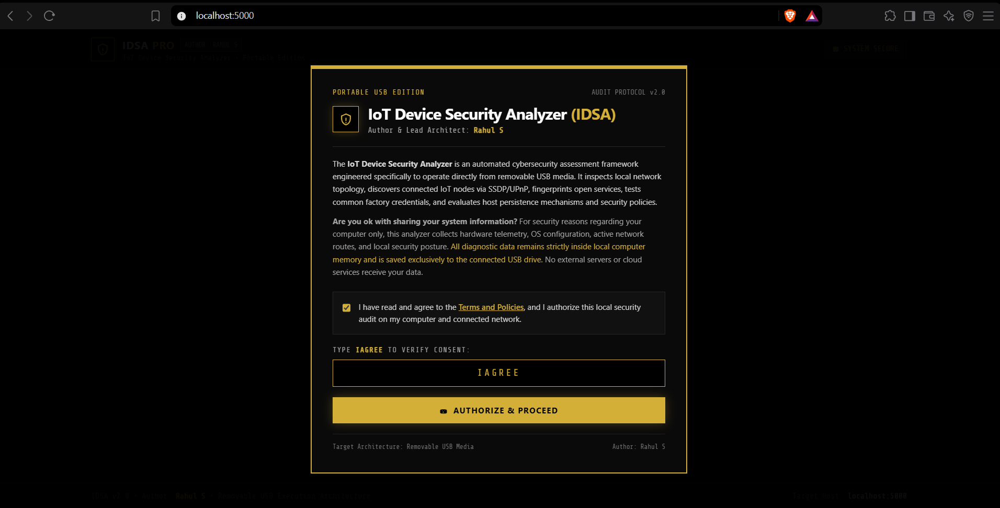
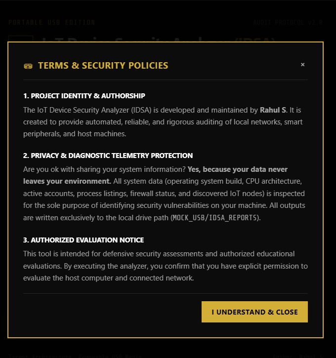
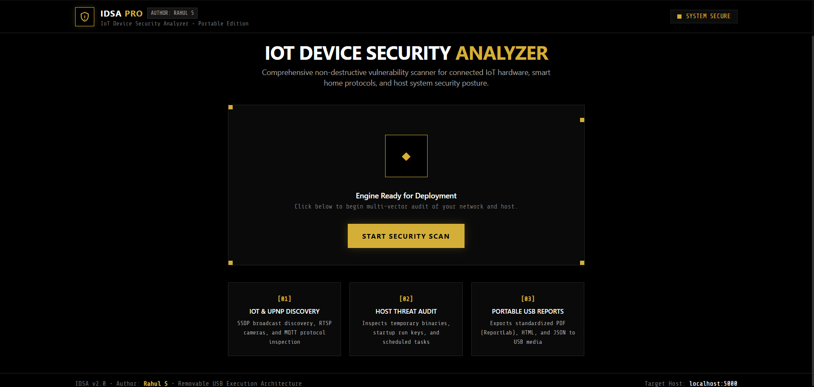
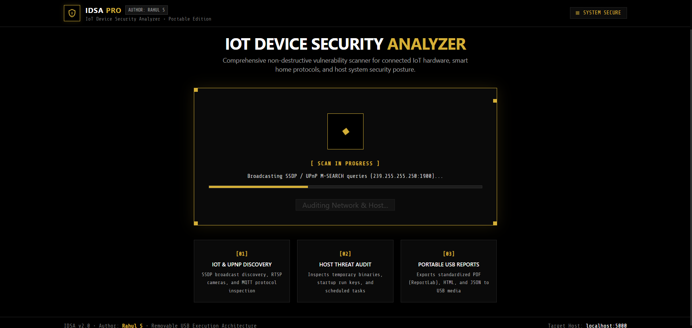
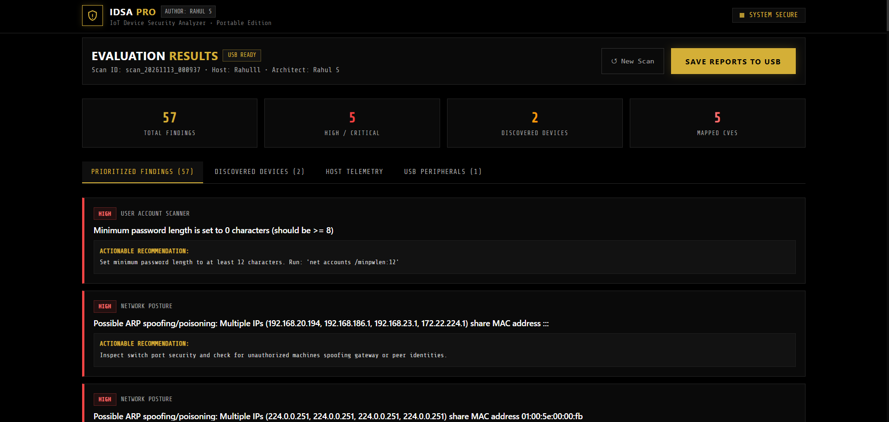
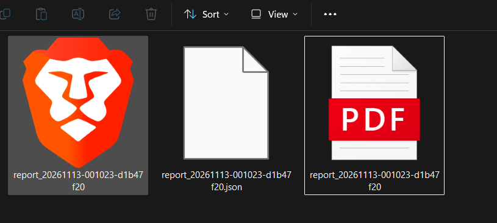
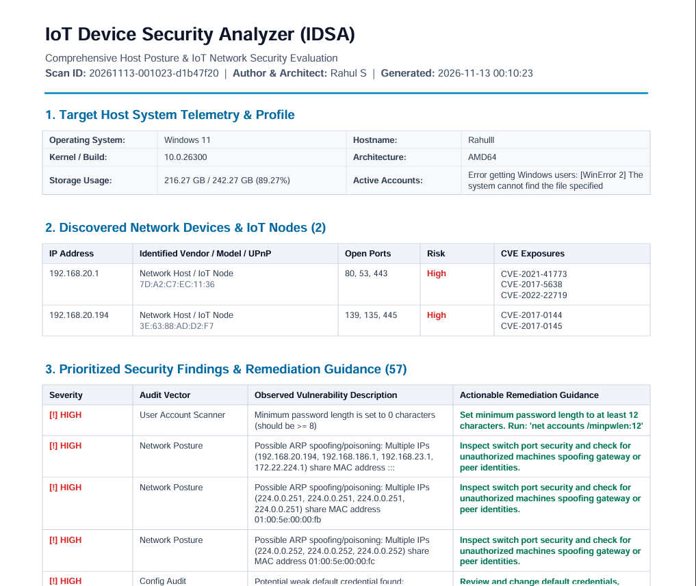

# IoT Device Security Analyzer (IDSA)

A portable, hardware-independent cybersecurity evaluation framework designed for authorized penetration testing, vulnerability assessment, and host posture auditing of IoT networks and computer endpoints. Operates entirely from removable USB media, provides a browser-based simulation interface, and exports standardized security reports.

**Author & Lead Architect: Rahul S**

---

## Architectural Philosophy & Design

The suite is engineered around Clean Architecture principles, ensuring that data gathering, protocol probing, web rendering, and persistent storage remain independent and modular:

```
[ Pure Black & Metallic Gold Web UI (React 18 + Tailwind CSS) ]
                                |
                           (HTTP / JSON)
                                |
[ Express.js Application Server (backend/) ]
   |-- config/          Runtime environment & dynamic USB path binding
   |-- middleware/      JWT token authentication, rate limiters, Helmet
   |-- controllers/     Endpoint controllers (auth, scan, system telemetry)
   |-- services/        Python engine runner & file management
   `-- routes/          Centralized REST API routing
                                |
                 (Process Interception Bridge)
                                |
[ Python 3 Multi-Vector Security Engine (IDSA_Existing/) ]
   |-- runner/          CLI dispatcher (scan_runner.py)
   |-- scanners/        Modular threat & protocol auditing packages
   |   |-- iot_discovery.py            (SSDP / UPnP M-SEARCH broadcast probing)
   |   |-- banner_grabber.py           (HTTP headers, titles, RTSP fingerprints)
   |   |-- iot_protocols.py            (MQTT anonymous brokers, RTSP cameras)
   |   |-- credential_auditor.py       (Safe factory default credential testing)
   |   |-- network_scanner.py          (Concurrent ping sweeps & port enumeration)
   |   |-- network_security_scanner.py (DNS integrity, ARP spoofing, Firewall)
   |   |-- process_scanner.py          (Suspicious temp binaries, hidden commands)
   |   |-- persistence_scanner.py      (Registry Run keys, Startup, Tasks)
   |   |-- user_account_scanner.py     (Guest account, password policy audit)
   |   |-- config_scanner.py           (Insecure protocol configuration checks)
   |   |-- system_scanner.py           (OS, architecture, hardware telemetry)
   |   `-- usb_scanner.py              (USB controllers & attached peripherals)
   `-- report_generator.py             (Binary ReportLab PDF, HTML, JSON)
                                |
                                v
[ Removable Media Output: MOCK_USB/IDSA_REPORTS/<scan_id>/ ]
```

---

## Complete Project Structure

```
IoT Device Security Analyzer (IDSA)/
|-- backend/
|   |-- config/
|   |   `-- index.js                  Dynamic paths, port, and JWT environment
|   |-- controllers/
|   |   |-- authController.js         Physical IAGREE verification & token issuance
|   |   |-- scanController.js         Engine trigger & report dispatching
|   |   `-- systemController.js       Host diagnostics & platform health
|   |-- middleware/
|   |   |-- auth.js                   JWT verification layer
|   |   `-- rateLimiter.js            IP request rate throttling
|   |-- routes/
|   |   `-- index.js                  Unified REST routing table
|   |-- services/
|   |   |-- pythonRunner.js           Subprocess lifecycle manager
|   |   `-- scanService.js            Buffer orchestrator & file cache
|   |-- package.json
|   `-- server.js                     Express server entry point
|
|-- frontend/
|   |-- build/                        Compiled production bundle
|   |-- public/                       Static assets
|   |-- src/
|   |   |-- components/
|   |   |   |-- ConsentModal.jsx      Terms, policy popup & single checkbox
|   |   |   |-- Dashboard.jsx         Boxy gold control radar & scan steps
|   |   |   |-- DeviceCard.jsx        Hardware metadata, UPnP tags & CVE links
|   |   |   |-- Footer.jsx            Author attribution & port status
|   |   |   |-- Header.jsx            Metallic gold security shield & status
|   |   |   `-- Results.jsx           Prioritized high-to-low findings table
|   |   |-- App.jsx                   Global application state manager
|   |   |-- index.css                 Pure black & gold boxy styling definitions
|   |   `-- index.js                  React DOM entry
|   |-- tailwind.config.js            Gold & Black color configuration
|   `-- package.json
|
|-- IDSA_Existing/
|   |-- runner/
|   |   `-- scan_runner.py            Command-line engine bridge
|   |-- scanners/
|   |   |-- __init__.py               Python package initialization
|   |   |-- banner_grabber.py         HTTP/RTSP service fingerprinting
|   |   |-- config_scanner.py         Exposed port security audit
|   |   |-- credential_auditor.py     Safe factory default credential testing
|   |   |-- cve_scanner.py            Local CVE dictionary lookup
|   |   |-- iot_discovery.py          SSDP/UPnP M-SEARCH broadcast listener
|   |   |-- iot_protocols.py          MQTT anonymous broker & RTSP stream audit
|   |   |-- network_scanner.py        Subnet ping sweep & port audits
|   |   |-- network_security_scanner.py DNS integrity, ARP cache, Firewall state
|   |   |-- persistence_scanner.py    Windows Run keys, Startup folder, Tasks
|   |   |-- process_scanner.py        Process threat & temporary path scanner
|   |   |-- system_scanner.py         Host OS & architecture telemetry
|   |   |-- usb_scanner.py            USB peripheral enumerator
|   |   `-- user_account_scanner.py   Guest accounts & password policy audit
|   |-- report_generator.py           Binary ReportLab PDF & HTML generator
|   `-- requirements.txt              Python dependencies
|
|-- assets/
|   `-- cve_database.json             Local reference CVE database
|
|-- MOCK_USB/
|   `-- IDSA_REPORTS/                 Report storage simulating USB drive
|
|-- Screenshots/                      Official interface execution screenshots
|   |-- 1.png                         Authorization & single-checkbox consent gate
|   |-- 2.png                         Terms and Policies popup window
|   |-- 3.png                         Main dashboard ready state
|   |-- 4.png                         Active multi-vector scan in progress
|   |-- 5.png                         Prioritized findings & defensive recommendations
|   |-- 6.png                         Discovered IoT devices & service fingerprints
|   `-- 7.png                         ReportLab PDF assessment document
|
|-- launch.bat                        Portable Windows batch launcher
|-- launch.ps1                        Portable PowerShell launcher
|-- .env.example                      Template for local secrets
`-- README.md
```

---

## Visual Walkthrough & Screenshots

### 1. Authorization & Single-Checkbox Consent Gate
The entry gate requires physical consent, informs the user of strict local USB telemetry processing, and provides a single standard agreement checkbox with a separate Terms & Policies popup window before accepting the `IAGREE` passphrase.



### 2. Independent Terms & Security Policies Popup
An in-app modal detailing project identity, authorship by Rahul S, the defensive assessment notice, and the zero-cloud-telemetry guarantee.



### 3. Dashboard Ready State
Pure Black and Metallic Gold boxy dashboard displaying engine status, audit vector summaries, and the main evaluation trigger.



### 4. Active Scan Execution
Animated radar tracker displaying real-time scanning steps across network sweeps, SSDP broadcasts, protocol checks, and host telemetry.



### 5. Prioritized Security Findings & Remediation Guidance
Findings are sorted strictly from **High to Low (Critical, High, Medium, Low, Informational)** with actionable recommendations for defensive hardening.



### 6. Discovered IoT Devices & Service Fingerprints
Enumerates discovered hardware nodes with UPnP verification tags, open listening ports, web page titles, and direct NVD CVE reference links.



### 7. Standardized ReportLab PDF Document
Official vector PDF report generated directly to the USB media (`%PDF-1.4`) with host telemetry, prioritized risk tables, and author attribution.



---

## Core Security Audit Vectors

1. **Active SSDP / UPnP Discovery (`iot_discovery.py`)**:
   - Sends `M-SEARCH * HTTP/1.1` UDP multicasts to `239.255.255.250:1900`.
   - Parses XML descriptors to identify device friendly names, hardware models, and manufacturers without relying on MAC guessing.

2. **Service Banner Grabbing & Web Fingerprinting (`banner_grabber.py`)**:
   - Sends protocol probes across open ports (HTTP, HTTPS, SSH, FTP, Telnet, RTSP).
   - Extracts HTML `<title>` tags, `Server:` response headers, and `WWW-Authenticate` realms.

3. **Specialized IoT Protocols (`iot_protocols.py`)**:
   - **MQTT Brokers (Port 1883)**: Tests for unauthenticated, anonymous broker access leaking live sensor telemetry.
   - **RTSP IP Camera Feeds (Port 554)**: Tests for unauthenticated `DESCRIBE` endpoints exposing public surveillance feeds.

4. **Safe Default Credential Auditing (`credential_auditor.py`)**:
   - Safely checks detected web management portals against common factory credentials (`admin:admin`, `admin:password`, `admin:1234`, `root:root`).
   - Flags critical exposures that enable automated botnet propagation.

5. **Host Persistence Mechanism Inspection (`persistence_scanner.py`)**:
   - Audits Windows Registry Run keys (`HKLM` / `HKCU` `Software\Microsoft\Windows\CurrentVersion\Run`).
   - Audits the user's Startup folder.
   - Inspects active Scheduled Tasks for unauthorized non-system tasks surviving reboots.

6. **Process Threat Analysis (`process_scanner.py`)**:
   - Detects executables launching out of temporary folders (`%TEMP%`, `%APPDATA%`).
   - Flags obfuscated command strings (e.g. encoded PowerShell `-enc` / `-w hidden`).
   - Checks against known attacker tooling (Mimikatz, netcat, cryptominers).

7. **User Account & Password Policy Audit (`user_account_scanner.py`)**:
   - Flags active Guest accounts.
   - Identifies accounts with no password requirement.
   - Audits members of the local `Administrators` security group.
   - Validates minimum password length against policy requirements.

8. **Network Posture & Integrity (`network_security_scanner.py`)**:
   - **DNS Hijack Detection**: Detects rogue loopback or proxy resolvers.
   - **ARP Spoofing Detection**: Identifies duplicate MAC addresses mapped to multiple IPs.
   - **Firewall Audit**: Checks active state of Domain, Private, and Public profiles.
   - **Service-to-PID Mapping**: Links open TCP/UDP listening ports to owning process names and PIDs.

---

## Portable USB Execution Instructions

The tool is completely portable and can be deployed directly from a USB flash drive without requiring installation on the host machine:

1. Copy the project root directory onto your USB flash drive.
2. Ensure Python 3.10+ and Node.js 18+ are installed on the host machine (or place portable builds in `tools/python/` and `tools/node/`).
3. Copy `.env.example` to `.env` on the drive root and verify your private secret.
4. Double-click `launch.bat`.
5. The launcher starts the backend server and automatically opens your default browser at `http://localhost:5000`.
6. Review the terms, check the confirmation box, type `IAGREE`, and click **Authorize & Proceed**.
7. Click **Start Security Scan** to execute the multi-vector audit.
8. Click **Save Reports to USB** to write the prioritized PDF, HTML, and JSON reports to `MOCK_USB/IDSA_REPORTS/<scan_id>/`.

---

## API Reference

| Method | Endpoint | Authorization | Description |
|---|---|---|---|
| `GET` | `/api/health` | None | Returns engine status, host name, platform, and paths |
| `POST` | `/api/approve` | None | Validates `IAGREE` consent and issues JWT session token |
| `POST` | `/api/scan` | JWT Bearer | Triggers multi-vector scan and returns structured JSON |
| `POST` | `/api/generate-report` | JWT Bearer | Compiles ReportLab PDF, interactive HTML, and JSON |
| `GET` | `/api/reports` | JWT Bearer | Lists all generated reports on the USB drive |
| `GET` | `/api/reports/:id/:file` | JWT Bearer | Securely downloads a specific report artifact |

---

## Future Roadmap & Extensibility

The following enhancements are planned for future iterations:
- **Active NVD API Dynamic Sync**: Real-time integration with the National Vulnerability Database API to pull fresh CVE scores and CVSS v3.1 metrics dynamically.
- **BLE & Zigbee Radio Scanners**: Hardware-level support for USB software-defined radios (SDR) and Bluetooth Low Energy adapters to audit smart locks and wireless sensor nodes.
- **Automated Remediation Scripting**: One-click generation of PowerShell and Bash hardening scripts tailored to the exact vulnerabilities discovered on the target machine.

---

## Conclusion & Legal Notice

The **IoT Device Security Analyzer (IDSA)** bridges the gap between passive host telemetry and deep IoT network auditing. By combining automated UPnP discovery, service banner extraction, specialized protocol auditing, and host persistence inspections into a portable, zero-installation USB workflow, it provides defensive evaluators and system administrators with a comprehensive assessment of their security posture.

**Legal Notice:** This software is designed solely for educational purposes and authorized security evaluations on networks and systems where explicit written permission has been granted. Unauthorized scanning or penetration testing of third-party infrastructure is strictly prohibited. The author assumes no liability for misuse.

**Author: Rahul S**
