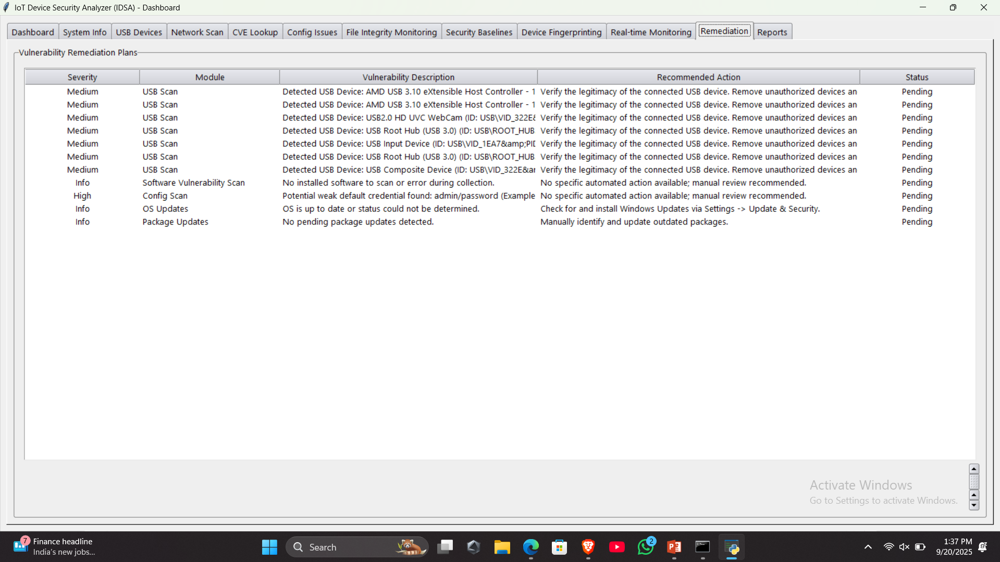
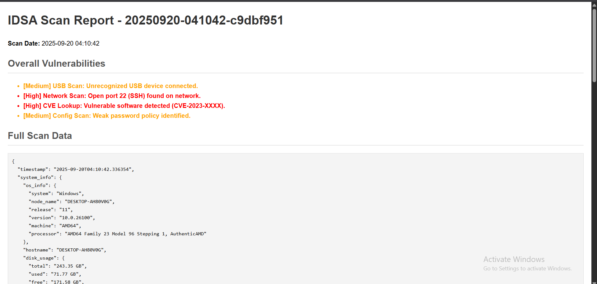

# IoT Device Security Analyzer (IDSA)

> **A full-stack cybersecurity tool** — Python scanner modules wrapped in a Node.js Express API and a dark-themed React dashboard.



---

## 🏗 Architecture

```
┌──────────────────────┐     HTTP/JSON      ┌────────────────────────┐
│   React Frontend     │ ◄────────────────► │   Node.js Backend      │
│   localhost:3000     │   (proxied in dev) │   localhost:5000       │
└──────────────────────┘                    └────────┬───────────────┘
                                                     │ child_process.spawn
                                                     ▼
                                       ┌─────────────────────────────┐
                                       │  IDSA_Existing/runner/      │
                                       │  scan_runner.py             │
                                       └─────────┬───────────────────┘
                                                 │ imports
                                    ┌────────────▼──────────────────┐
                                    │  Python Scanner Modules        │
                                    │  network_scanner.py            │
                                    │  system_scanner.py             │
                                    │  usb_scanner.py                │
                                    │  cve_scanner.py                │
                                    │  config_scanner.py             │
                                    │  report_generator.py           │
                                    └────────────────────────────────┘
                                                 │ reports saved to
                                    ┌────────────▼──────────────────┐
                                    │  MOCK_USB/IDSA_REPORTS/        │
                                    │  (simulated USB drive)         │
                                    └────────────────────────────────┘
```

---

## 📁 Project Structure

```
IoT Device Security Analyzer (IDSA)/
│
├── IDSA_Existing/              ← Original Python scanner (untouched)
│   ├── runner/
│   │   └── scan_runner.py      ← CLI bridge: Node ↔ Python
│   ├── main.py                 ← Original Tkinter GUI (still works)
│   ├── network_scanner.py
│   ├── system_scanner.py
│   ├── usb_scanner.py
│   ├── cve_scanner.py
│   ├── config_scanner.py
│   └── report_generator.py
│
├── assets/
│   └── cve_database.json       ← Local CVE database (13 real CVEs)
│
├── backend/                    ← Node.js Express API
│   ├── server.js
│   └── package.json
│
├── frontend/                   ← React + Tailwind CSS UI
│   ├── public/index.html
│   ├── tailwind.config.js
│   ├── postcss.config.js
│   └── src/
│       ├── App.jsx
│       ├── index.js / index.css
│       └── components/
│           ├── ConsentModal.jsx   ← "IAGREE" gate
│           ├── Dashboard.jsx      ← Animated radar + scan trigger
│           ├── Results.jsx        ← 4-tab results view
│           ├── DeviceCard.jsx     ← Expandable device card
│           ├── Header.jsx
│           └── Footer.jsx
│
├── MOCK_USB/
│   └── IDSA_REPORTS/           ← Reports saved here (simulated USB)
│
├── Screenshots/                ← UI screenshots
└── .gitignore
```

---

## 🚀 Quick Start

### Prerequisites
- **Python 3.10+** with the packages in `IDSA_Existing/requirements.txt`
- **Node.js 18+** and npm

### 1 — Install Python dependencies
```bash
cd IDSA_Existing
python -m venv .venv
# Windows:
.venv\Scripts\activate
# macOS/Linux:
source .venv/bin/activate
pip install -r requirements.txt
```

### 2 — Install Node dependencies

```bash
# Backend
cd backend
npm install

# Frontend
cd ../frontend
npm install
```

### 3 — Run (Development Mode — two terminals)

**Terminal 1 · Node backend**
```bash
cd backend
npm start          # http://localhost:5000
```

**Terminal 2 · React frontend**
```bash
cd frontend
npm start          # http://localhost:3000
```

Open **http://localhost:3000** in your browser.

### 4 — Run (Production Mode — single terminal)

```bash
# Build the React app first
cd frontend
npm run build

# Then start just the Node server — it serves both API + React
cd ../backend
npm start          # http://localhost:5000 serves everything
```

---

## 🔌 API Endpoints

| Method | Endpoint | Description |
|--------|----------|-------------|
| `POST` | `/api/scan` | Run full scan; returns JSON with device list |
| `POST` | `/api/generate-report` | Generate HTML/JSON/PDF → `MOCK_USB/IDSA_REPORTS/` |
| `GET`  | `/api/reports` | List saved report folders |
| `GET`  | `/api/reports/:id/:file` | Download a report file |
| `GET`  | `/api/health` | Health check / path info |

---

## 🛡 Features

- **Consent Gate** — requires typing `IAGREE` before any scan
- **Network Discovery** — ping sweep + concurrent port scan of LAN
- **CVE Mapping** — maps open ports to known CVE IDs (EternalBlue, BlueKeep, etc.)
- **Configuration Analysis** — detects weak credentials, exposed SMB/Telnet/RDP
- **System & USB Info** — OS details and connected USB device enumeration  
- **Report Export** — JSON + HTML + PDF saved to `MOCK_USB/IDSA_REPORTS/`
- **Dark Cybersecurity UI** — Tailwind CSS dark theme with cyan accents

---

## ⚠️ Legal Disclaimer

This tool is for **educational and authorized security testing purposes only**.  
You must have **explicit written permission** to scan any network or device you do not own.  
The developers assume no liability for misuse.

---

## 📸 Screenshots

| Consent Gate | Dashboard | Results |
|---|---|---|
|  |  |  |

